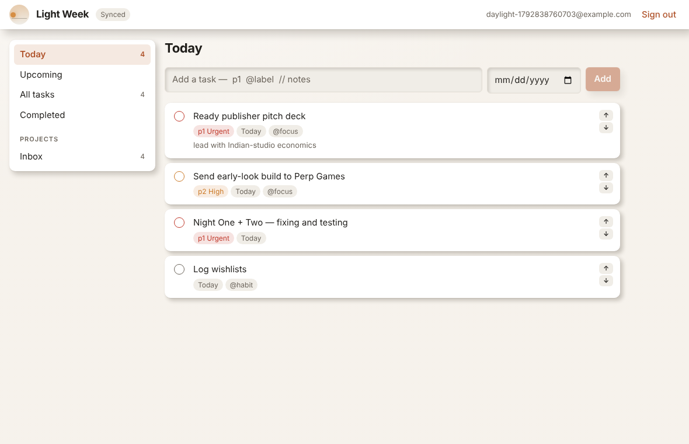
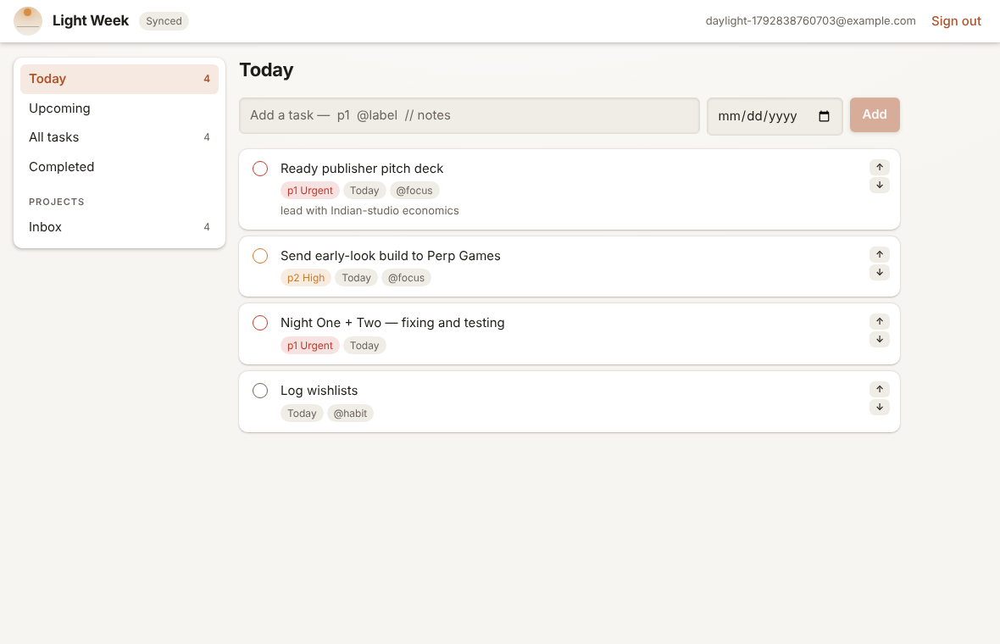
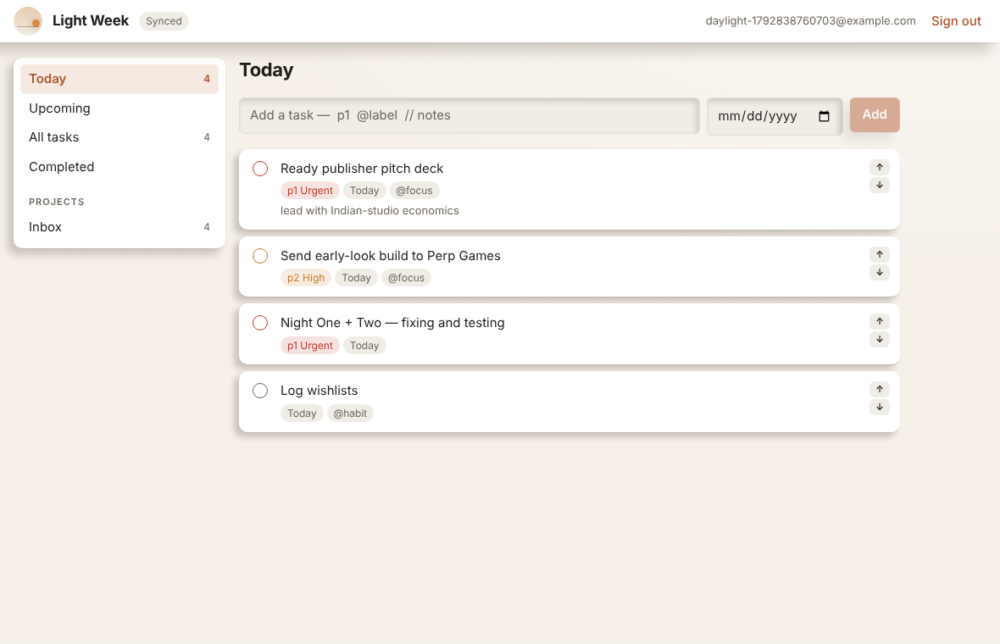
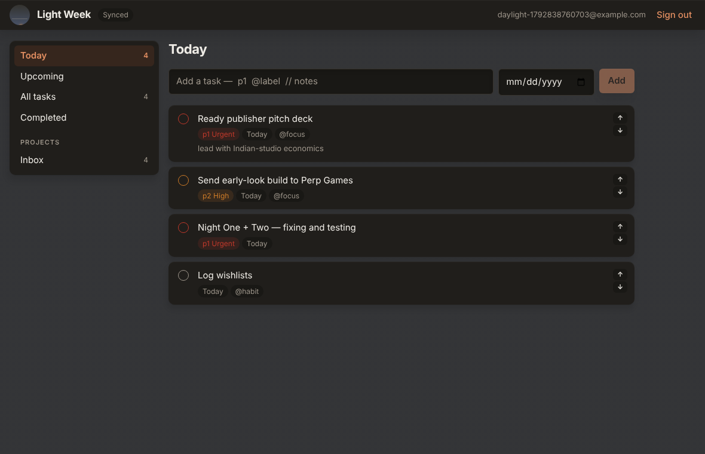

# Diurnal

A UI kit that treats the page like a desktop and uses the time of day to cast
shadows.

| 07:00 | 12:00 | 17:30 | 23:00 |
| --- | --- | --- | --- |
|  |  |  |  |

Same screen, four hours. At dawn the sun is in the east, so shadows stretch to
the right. At noon it is overhead and they collapse to almost nothing. By dusk
they have swung left. After dark the palette turns over and the light goes
cool and soft.

## The idea

Most design systems pick one shadow and use it forever. Diurnal instead treats
the page as a physical surface with a light source above it, and derives every
shadow from where that light actually is. Components do not specify a shadow;
they specify how high off the surface they sit, and the light does the rest.

```tsx
import { DiurnalProvider, Surface, Panel, Button } from "@light/diurnal";
import "@light/diurnal/diurnal.css";

<DiurnalProvider>
  <Surface>
    <Panel level={1}>A card resting on the desk</Panel>
    <Panel level={3}>A dialog, floating well above it</Panel>
    <Button variant="primary">Pressing this pushes it down</Button>
  </Surface>
</DiurnalProvider>
```

## How it works

`sunPosition()` returns where the light is. Two models:

- **Clock only** (the default). The sun rises, arcs overhead, and sets on a
  configurable schedule. Needs nothing but the local time.
- **Real solar position**, if you pass coordinates. Proper astronomy, so a
  December afternoon in London gets a genuinely low sun and long shadows, and
  Tromsø in June gets a sun that never sets.

Asking for location permission to decide a shadow angle would be a poor trade,
so the simple model is the default.

`tokensFor()` turns that into numbers, which the provider writes onto the
document root as custom properties. The stylesheet then has exactly one shadow
expression that every component shares:

```css
.dn-raised {
  box-shadow:
    inset calc(var(--dn-light-x) * -1px) 1px 0 rgb(… / var(--dn-highlight-alpha)),
    0 calc(var(--dn-e) * 1px) calc(var(--dn-e) * 2px) rgb(… / var(--dn-contact-alpha)),
    calc(var(--dn-shadow-x) * var(--dn-shadow-length) * var(--dn-e))
    calc(var(--dn-shadow-y) * var(--dn-shadow-length) * var(--dn-e))
    calc(var(--dn-shadow-blur) * var(--dn-e))
    rgb(… / var(--dn-shadow-alpha));
}
```

Three layers: a lit edge facing the sun, a tight contact shadow that keeps an
object attached to the surface at any angle, and the cast shadow that stretches
and swings through the day.

## What does not change with the light

**Text and background contrast.** A theme that drifts continuously is an
excellent way to produce something unreadable by mid-afternoon, so the palette
has exactly two states — light and dark — and a test asserts it switches
exactly twice across a day rather than flickering. Only the lighting is
continuous.

Shadows also always fall *downward*, at every hour, because the light is always
above the page. Nothing ever casts upward.

## Components

`Surface` · `Panel` · `Button` · `TextField` · `Checkbox` · `Chip` · `NavItem` ·
`Heading` · `Text` · `Stack` · `Inline` · `Divider` · `SunDial`

`SunDial` is a small readout of where the light currently is. It exists so the
kit can explain itself: the shadows move, and someone who notices deserves to
be able to find out why.

## Options

```tsx
<DiurnalProvider
  latitude={13.7563} longitude={100.5018}  // real solar position
  sunriseHour={6} sunsetHour={18}          // or just a schedule
  scheme="follow"                          // or "light" / "dark" to overrule the sky
  tickMs={60_000}
  now={() => new Date("2026-06-21T07:00:00")}  // fixed, for stories and tests
/>
```

The default tick is a minute. Over a day the light moves about a quarter of a
degree a minute; anything faster is burning wakeups to animate something nobody
is watching. `prefers-reduced-motion` turns the transitions off entirely.

## Status

Early, and currently proved out by exactly one application — Light Week, in
this repository. 34 unit tests cover the solar models and the token
derivation; `apps/web/e2e/daylight.mjs` shoots a real page at four hours, which
is how the images above were made.

Not done: a component gallery, Figma parity, and anything that is not a web
target. It lives inside this monorepo for now because it has one consumer; it
is MIT and has no dependency on the rest of Light Suite, so pulling it out into
its own repository is a `git filter-repo` away when it earns that.
